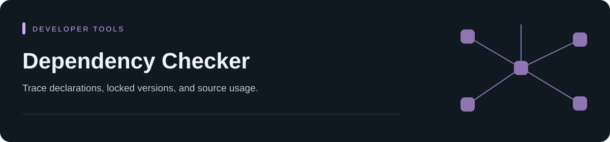

# Dependency Checker

[](https://hub.xerj.org/contributors/steventimes)

> **Start with a question:** What is declared, which versions are locked, where
> is a package referenced, and what evidence would an update affect?

Dependency Checker provides the `check-dependencies` Agent Skill for repository
dependency audits. Its MCP tools and `depcheck` CLI share a scanner that collects
declarations, locked versions, and source usage. An agent can inspect a package,
explain its impact, and preview a supported update from that evidence.

Repository files are parsed as data. Scans do not import target project code or
run its package managers.

[Agent setup](#use-with-a-coding-agent) · [First audit](#first-offline-audit) ·
[CLI](#cli) · [Coverage](#ecosystem-coverage) · [Architecture](#architecture) ·
[Changelog](CHANGELOG.md) · [Contributing](CONTRIBUTING.md) · [Security](SECURITY.md)

This source uses release line **0.6.0**. Download versioned Agent Skill bundles
and their SHA-256 checksums from [GitHub Releases](https://github.com/steventimes/dependency-checker/releases).
The backend is distributed in the bundle and as GitHub wheel/source assets.
The PyPI project named `depcheck` belongs to a different project; do not use
`pip install depcheck` to install this tool.

Version 0.6.0 includes the changes documented in the
[changelog](CHANGELOG.md#060--2026-11-01). Older bundles retain their original
backend and evidence contracts:

| Backend | Package version | Analysis revision | Index schema | MCP tools |
| --- | --- | --- | --- | --- |
| Previous 0.5.0 release | 0.5.0 | 57 | v4 | 18 |
| 0.6.0 source/bundle | 0.6.0 | 88 | v8 | 19 |

For the current source, `depcheck runtime` or MCP `backend_info` identifies the
running backend. Neither operation refreshes the index. Check context freshness
separately and refresh older evidence with the matching backend.

## Capabilities

- Components are identified by
  `(project_id, ecosystem, package, version, instance)`.
- Reports missing, unused, unpinned, conflicting, and scope-mismatched dependencies
  when the collected evidence supports those findings.
- Exact-version OSV queries for qualified PyPI, npm and crates.io records.
  Maven coordinates require an explicit caller assertion of public origin. Go
  advisory ranges are supported, but current manifest collection does not
  establish the selected versions needed for a Go query.
- Python compatibility analysis backed by PyPI metadata when explicitly enabled.
- Text, `depcheck.scan.v1` JSON, SARIF 2.1.0, and CycloneDX 1.7 output.
- A rebuildable `depcheck.index.v8` SQLite evidence index.
- Qualified inventory queries, dependency explanations, impact analysis, and
  read-only update previews for Python requirements and static PEP 621 entries.
- CLI and MCP interfaces over the same scanner, model, index, and service layer.

The current source also collects literal Hatch environment declarations and
Hatch/Poe task references from pyproject files. Separate environment commands
do not count as application usage. Inheritance, dynamic task configuration and
execution remain unknown. See the [Python reference](skills/check-dependencies/references/ecosystems/python.md#hatch-environments-and-poe-tasks).
The existing evidence operation accepts saved native `pip inspect` and
`pip install --report` v1 reports. Installation reports may describe a dry-run.
These records remain external assertions and do not establish public package
origins or current installation. See [external evidence](skills/check-dependencies/references/external-evidence.md).

The current source reads PEP 751 `pylock.toml` and named `pylock.NAME.toml`
version 1.0 inventories. It retains source, condition and artifact assertions;
source trees without a stable version stay unversioned. Environment selection
and installation remain unknown. See the [Python reference](skills/check-dependencies/references/ecosystems/python.md).

Pipenv custom categories and repeated lock records retain their own scope and
source context. Category activation remains unknown, and the flat lock does not
provide dependency edges. See the [Python reference](skills/check-dependencies/references/ecosystems/python.md).

Scan results separate dependency findings from analysis failures. Skipped,
unsupported, and failed stages keep the overall result incomplete.

## Use with a coding agent

Download the
[v0.6.0 bundle](https://github.com/steventimes/dependency-checker/releases/download/v0.6.0/dependency-checker-0.6.0.zip)
and check it against
[SHA256SUMS](https://github.com/steventimes/dependency-checker/releases/download/v0.6.0/SHA256SUMS).
Extract it and use your agent host's skill or plugin loader. The
0.6.0 bundle contains:

| Entry | Purpose |
| --- | --- |
| `skills/check-dependencies/SKILL.md` | Dependency audit workflow and reporting rules |
| `skills/check-dependencies/references/` | Backend, transport, and ecosystem guidance loaded for the requested task |
| `skills/check-dependencies/agents/openai.yaml` | Skill display metadata |
| `.codex-plugin/plugin.json`, `plugin.json` | Plugin descriptors |
| `.mcp.json`, `mcp.json` | MCP server launch configuration |
| `depcheck/`, `pyproject.toml`, `uv.lock` | Scanner, CLI, and locked backend environment |

The Skill needs an available MCP server or an installed `depcheck` CLI. A copied
Skill directory provides instructions; set up its backend before requesting an
audit. The bundled launchers use uv 0.12.4 and Python 3.11 or newer.

From the extracted bundle directory, install the agent backend:

```bash
uv sync --frozen --extra agent
uv run --frozen --extra agent depcheck --version
```

For a client that needs an explicit server command, use absolute paths for the
backend and the repository being audited:

```bash
uv run --project "/absolute/path/to/dependency-checker" --extra agent --frozen depcheck-mcp --allow-root "/absolute/path/to/your-repository"
```

The bundled descriptors use `cwd: "./"`; their working directory must resolve
to the bundle root. MCP clients that supply repository roots can omit
`--allow-root`. See [MCP and agent integration](#mcp-and-agent-integration) for
root precedence and tool side effects.

Request an audit with a concrete repository path, or ask why a package is
present and what an update would affect. The Skill checks coverage and follows
inventory pagination before drawing conclusions. If MCP is unavailable, it can
use the installed CLI.

The Skill entry links to shared workflow and task-specific guidance in
`skills/check-dependencies/references/`. Keep the whole Skill directory when
copying or bundling it. The earlier 0.4.0 Skill predates this split and keeps its
guidance in the entry file. Reference paths are relative to the Skill directory,
even when the audited repository is elsewhere. This follows
[OpenAI's skill guidance](https://learn.chatgpt.com/docs/build-skills) on loading
instructions and supporting resources as needed.

### From audit to dependency maintenance

Use the static evidence to choose a bounded change before starting an update.
The `check-dependencies` Skill provides inventory, usage, coverage and previews.
A dependency-maintenance workflow, such as `dependency-manager`, handles native
resolution, installation and verification after the user authorizes changes.

| Stage | Evidence or action |
| --- | --- |
| Baseline | Inspect Git status, owning manifests and locks, runtime/package-manager pins, CI checks, and existing failures. Keep unknown resolved versions explicit. |
| Select | Use qualified package identities, declarations, impact and advisories to choose one ecosystem or coupled package family. Check migrations for major changes. |
| Apply | Use the project's existing package manager and pinned version. Regenerate generated lockfiles through that manager; depcheck previews do not apply them. |
| Verify | Reinstall in the project's locked mode, compare the resolved graph, run focused and broader checks, then report versions, advisories and failures before and after. |

These maintenance actions are separate from scanner execution. Unsupported Ruby,
PHP or .NET manifests can leave coverage incomplete even when a maintenance
agent can work with their native package managers.

## CLI installation

Python 3.11 or newer is required. From a source checkout or extracted bundle:

```bash
python -m venv .venv
.venv/bin/python -m pip install -e .
.venv/bin/depcheck --version
```

On Windows, use `.venv\Scripts\python.exe` and `.venv\Scripts\depcheck.exe`.
Install `.[agent]` to add MCP support, or follow the locked setup above. For the
development and test environment, see [Development](#development).

### First offline audit

The following examples assume `depcheck` is on PATH. With the source environment
above, use the full path to its executable if needed. Use the [development environment](#development) when working from source; an
older bundle may have an earlier analysis revision.

In an empty scratch directory, create `requirements.txt`:

```text
requests==2.32.4
```

Create `app.py` in the same directory:

```python
import requests
```

From that directory, run:

```bash
depcheck scan . --offline --format json
```

The JSON includes these fields (excerpt):

```json
{
  "inventory": {"declaration_count": 1, "usage_count": 1},
  "capabilities": {"security": {"state": "skipped"}}
}
```

No index or cache setup is required for this first scan. The scanner found one
declared dependency and one static reference. It did not
install requests or execute `app.py`. Security was skipped because this scan was
offline, so the result does not establish vulnerability status. A real project
can have additional diagnostics, unknown versions or incomplete usage.

## CLI

Identify the current source backend without reading a repository:

```bash
depcheck runtime
```

This returns `depcheck.runtime.v1` with backend version, analysis revision,
index schema and tool contract revision. It is separate from inspecting a
supplied runtime trace. Older release backends may not provide this command.

Scan offline and emit canonical JSON:

```bash
depcheck scan . --offline --format json
```

Run security and Python compatibility analysis:

```bash
depcheck scan . --security --compatibility --python-version 3.12
```

### Public Maven coordinates

Static Maven/Gradle records do not establish which repository supplied a package.
An unqualified exact version receives `security.identity-unverified` and no
public lookup. After checking the source and authorizing network access, opt in
to one exact `group:artifact` coordinate:

```bash
depcheck scan . --security --no-compatibility --public-maven-coordinate org.slf4j:slf4j-api --format json
```

Repeat `--public-maven-coordinate` for additional coordinates. The Python API
accepts `RepositoryScanOptions.public_maven_packages`. These are caller-supplied
assertions, not repository configuration; MCP `scan_repository` remains offline.
The assertion does not establish installation, source authenticity or complete
security coverage. `--offline` still disables OSV, even with an asserted coordinate.

The current source can reevaluate a saved inventory against supplied OSV records
and add optional offline KEV JSON and EPSS CSV/gzip context. Only existing CVE
IDs or aliases create associations. Missing data stays unknown; probability,
percentile and feed age remain separate from version matches and severity.
See [supplied KEV and EPSS context](skills/check-dependencies/references/external-evidence.md#supplied-kev-and-epss-context)
for file arguments, validation, stale fallback and provenance limits.

### Reports and indexed queries

Create the report directory if needed, then export a report or build the derived
index for package-level questions:

```bash
python -c "from pathlib import Path; Path('.tmp').mkdir(exist_ok=True)"
depcheck scan . --offline --format sarif --output .tmp/depcheck.sarif
depcheck scan . --offline --format cyclonedx-json --output .tmp/bom.json
depcheck index .
depcheck query . requests --ecosystem PyPI --project pypi:python:. --limit 20 --offset 0
depcheck explain . requests --ecosystem PyPI --project pypi:python:.
depcheck impact . requests --ecosystem PyPI --project pypi:python:.
```

Use the project identity returned by your scan. CLI `scan` leaves the index
unchanged; `index` creates or replaces the cache. Queries reject stale indexes
and remain read-only. Refresh with `depcheck index .` after changing inputs.
Follow non-null `next_offset` values with the same filters; an empty page does
not establish complete evidence.

The [CLI reference](skills/check-dependencies/references/cli.md#reports-and-indexed-queries)
covers evidence pagination, response budgets, SARIF positions, snapshot
comparison and report handoffs. For saved SBOMs, CMake models, runtime traces,
CVE/CWE/VEX or other supplied records, follow the
[external evidence reference](skills/check-dependencies/references/external-evidence.md).

Compare two saved scans of the same repository and selection:

```bash
depcheck compare . .tmp/snapshots/before.json .tmp/snapshots/after.json --format text
```

Omit `--format text` for JSON. The result reports incompatible snapshots and
incomplete evidence; observed version changes do not verify remediation.
Follow `next_offset` for additional pages.
For scripts, add `--fail-on-changes`: exit 1 means observed changes across all
pages, exit 2 means invalid or incomparable inputs, and exit 0 means no
observed changes. The comparison covers additions and removals of declarations,
resolved dependencies, edges, and vulnerability identities with advisory IDs.
It does not count changes to an existing advisory's fix boundaries or severity.
With incomplete security evidence, exit 0 does not establish unchanged risk or
verified remediation.

### Exit policy

`--fail-on` accepts `any`, `incomplete`, `hygiene-incomplete`, `missing`, `unused`,
`unpinned`, `scope`, `duplicate`, `vuln`, or `compat`. Options may be
repeated. `incomplete` includes skipped stages; `hygiene-incomplete` checks
only dependency evidence, so the offline pre-commit hook can pass without an
OSV query. Command errors, including unsupported update targets, exit with code 2.
Policy failures exit with code 1.

A JSON policy file can add expiring, qualified exemptions:

```json
{
  "fail_on": ["missing", "vuln", "incomplete"],
  "exemptions": [
    {
      "id": "temporary-requests-exemption",
      "risk": "vuln",
      "package": "requests",
      "project_id": "pypi:python:.",
      "ecosystem": "PyPI",
      "advisory_ids": ["GHSA-example-reviewed-advisory"],
      "versions": ["2.31.0"],
      "reason": "Upgrade is scheduled",
      "owner": "platform",
      "expires_at": "2027-01-31"
    }
  ]
}
```

Pass it with `--policy policy.json`. Invalid, expired, or unmatched exemptions
remain observable; invalid and expired exemptions fail governance evaluation.
`advisory_ids` matches the finding ID or an alias and requires `risk: "vuln"`.
`versions` matches exact version strings; unknown versions do not match.
Each optional selector accepts 1–100 non-empty strings. When both are supplied,
both must match. Omitting them preserves the existing package-wide exemption.
Raw findings, security evidence and SBOM inventory remain available.

Explicit pyproject previews select static PEP 621 dependency groups:

```bash
depcheck update . "requests==2.32.4" --file pyproject.toml --group project
depcheck update . "requests==2.32.4" --file pyproject.toml --group optional:test
```

Without `--file`, updates continue to preview requirements files. With an
explicit pyproject file, omit `--group` only when each requested package has
one group; repeated packages across groups return `update.ambiguous-target`.
Previews preserve supported single-line string formatting and do not write
manifests or locks, apply upgrades, or establish compatibility. Dynamic
requirements, URL/VCS entries, multiline strings, and other dependency tables
remain unsupported. Invalid input returns `update.invalid-target`.

Previews select the owning Python component. Pass its returned `project_id` or
an explicit file when multiple components exist; unqualified updates return
`update.ambiguous-target`. Aliased update targets are rejected at the service
boundary. The `handoff` object records readiness, blocking reasons, baseline
coverage, source digests and pending verification. A group means the packages
were requested together; coupling stays unknown. `ready` means the preview can
be handed to maintenance. Runtime/package-manager pin checks, locked installation,
graph validation and tests remain `not-run` until that workflow executes them.

## Ecosystem coverage

<details>
<summary>Expand ecosystem evidence and format-specific limits</summary>

| Ecosystem | Evidence |
| --- | --- |
| Python / PyPI | `pyproject.toml`, requirements text and compiled requirements locks, setup metadata, Pipfile, supported locks, Docker/Make install hints, Python and notebook imports |
| JavaScript / npm | `package.json`, npm and pnpm v9 locks, independent Yarn Modern lock inventory, literal module imports, Astro frontmatter and supported script/style regions, CSS imports, resolved instance edges |
| Go modules | positioned minimum requirements, replacement/exclusion assertions, repeated `go.sum` checksums and literal imports; selected build versions remain unknown |
| Java/Kotlin / Maven or Gradle | local POM properties/management, bounded Gradle configuration calls, configuration-qualified locks, TOML catalog library definitions and imports |
| C/C++ / Conan or vcpkg | supported manifests, Conan v2 lock inventory, supplied vcpkg dependency inventory, includes and CMake `find_package` evidence; active build/installation remains unknown |
| CMake configuration | literal `FetchContent_Declare`, `find_package` and `find_dependency` assertions, bounded package-config templates, source options and positions; active graph and installed versions remain unknown |
| Rust / Cargo | `Cargo.toml`, workspace inheritance, dependency aliases and conditions, Cargo.lock v3/v4 instances and edges; conditional literal Rust crate references with inferred owners |
| Bazel / Bzlmod | literal top-level `bazel_dep` calls in `MODULE.bazel`, requested versions, repository aliases, development conditions and source positions; selected graph and build/source usage remain unknown |

Python lock versions are bound to direct declarations using compatible ranges
and unique source occurrences. Same-name versions are retained separately;
ambiguous or unverified bindings stay unknown. This does not select installed
versions, groups or extras. See [Python evidence](skills/check-dependencies/references/ecosystems/python.md).

Go `require` directives retain their minimum version with `scheme: go-minimum`.
An all-version module replacement retains a `go-replacement` assertion; a
version-specific replacement does not select a target from the minimum alone.
Repeated `go.sum` lines use `kind: checksum`, with separate module-archive and
`go.mod` hashes, original locations and `integrity_verified: false`. They do not
establish source usage, direct application edges or installed versions. CycloneDX
keeps them as `depcheck:checksum-assertion` properties on unversioned components.
Following the [Go module specification](https://go.dev/ref/mod#go-sum-files),
old checksums and minimum requirements do not establish the MVS build list.
Go resolution and security remain incomplete, and these records do not supply
exact versions to OSV. Workspace/vendor selection is uncollected; `go.work` and
`go.work.sum` expose uncovered manifest paths. Literal quoted
directive values are supported; escaped interpreted strings and uncollected
ignore or future directives leave explicit gaps. Metadata expansion is bounded.
Snapshot comparisons retain declaration metadata, including checksum-only changes;
the comparison does not verify either hash or establish remediation.

Literal Go `tool` directives provide positioned `kind: configuration`, build-scoped
usage. A declared module prefix or explicit mapping identifies the configured
owner; repeated directives remain separate. `// indirect` still marks a `require`
declaration and does not make that owner missing. Main-module and standard-library
tools do not become external dependencies. Declared modules nested under the
main module's path remain external candidates for tools and source imports.
Explicitly required local replacement modules without domain names are not
discarded as standard-library imports.
Unknown owners and exhausted evidence budgets leave explicit gaps. This is
configuration evidence, not proof that a package exists, ran or was installed;
selected versions and security remain unknown. See the
[Go tool directive](https://go.dev/ref/mod#go-mod-file-tool).

For Conan and vcpkg projects, `gtest/` and `gmock/` includes map to the shared
`gtest` package. C/C++ files named `*_test` or `*_unittest` (before the extension),
as in the [GoogleTest quickstart](https://google.github.io/googletest/quickstart-cmake.html)
and [samples](https://github.com/google/googletest/tree/main/googletest/samples),
carry test scope, as do files under `test/` or `tests/`. This is a filename/path
heuristic; it does not establish which build targets use the file. Other source
files retain their runtime scope. CMake `find_package(GTest)` is a build hint when
`gtest` is declared. Commented calls are ignored and multiline calls retain locations.

C/C++ include collection skips comments and quoted/raw-string examples, joins
standard escaped newlines and retains physical source positions. Headers inside
preprocessor conditions have `kind: conditional` and inferred confidence;
activation is unknown, so they do not establish missing packages or scope errors.
Macro operands, unsupported inclusion directives, malformed input and exhausted
lexical budgets leave explicit gaps. Compiler-dependent translation keeps only
its preceding evidence. No compiler or preprocessor is run.

Conan text/literal Python declarations and supported JSON inventory retain source
positions. Conan v2 locks keep repeated instances, recipe revisions and separate
`requires`, `build_requires`, `python_requires` and `config_requires` categories.
Locks can contain unused versions from multiple configurations. Version ranges
remain unresolved; neither a manifest pin nor a lock entry proves installation
or selection for the active build.

vcpkg root and feature dependencies retain platform expressions, minimum versions,
feature assertions, default-feature flags and override locations. Feature lists
use `kind: conditional`, with their feature group, support expressions and default
feature assertions. These declarations do not establish activation, installed
versions, or removal evidence. They produce no unused, unpinned, duplicate or
scope-mismatch advice without an active context. Other root declarations retain
their checks. Repeated groups survive explanations and CycloneDX properties;
conditional-only components add no direct application edge. Invalid feature
scopes and expansion beyond the bounded metadata budget leave explicit gaps.
Native `vcpkg-lock.json` caches registry references, not a resolved port graph.
The previously supported `dependencies` object in a supplied JSON file remains
readable as dependency inventory, with unknown activation. It is not the native
vcpkg lock format. Build triplets, feature selection and installed versions
remain unknown.

Maven build/reporting plugins, `pluginManagement` definitions and explicit plugin
dependencies are separate `kind: conditional`, build-scoped configuration
assertions. Default plugin groups, declaring-POM property assertions, source
positions, executions/report sets and profile conditions are retained. Local
parent assertions retain their source; literal inheritance flags are qualified,
including execution-level overrides. These are not a merged effective plugin
model. Management does not activate a plugin or supply a selected version here.
Local parent `relativePath` values may name a POM or a directory; slash and
backslash forms stay within the audited root after resolving `pom.xml`.
Profile-local properties, default lifecycle bindings and configuration bodies
remain unevaluated. Plugin dependencies belong to the plugin/build-extension
classpath and do not satisfy application dependency declarations. Configuration
adds no installed versions, application edges, public version queries or removal
advice from zero Java imports. Explicit `build/extensions/extension` records are
conditional build assertions in their declaring POM, with build-extension classpath
and raw scope/type/classifier fields. Parent extension configuration is not merged.
Explicit profile library and management declarations retain their profile, original
positions and raw requests as conditional inventory with unknown scope. They do
not supply unconditional versions, satisfy Java imports or qualify for public
advisory queries. Imports declared only in profile libraries retain an explicit
unknown-availability diagnostic. Profile activation and effective merging remain unknown;
unsupported activation conditions retain explicit coverage gaps.
Maven build resolution remains incomplete even without declared plugins because
implicit lifecycle defaults and the installed graph are uncollected. Maven and
Gradle coordinates do not establish a public repository source. Exact versions
remain inventory; public PURLs and OSV lookups require the caller's explicit
[public-coordinate assertion](#public-maven-coordinates).

Gradle Groovy/Kotlin build files supply positioned literal configuration calls,
including multiline calls, versionless coordinates, classifiers and supported
`platform`, `enforcedPlatform` and `testFixtures` wrappers. Comments and
documentation strings do not add dependencies. Calls retain their lexical
contexts and `kind: conditional`; constraint blocks stay separate. Their
`gradle-required` versions are requests, not selected pins, following
[Gradle's version semantics](https://docs.gradle.org/current/userguide/dependency_versions.html).
Both build files are inventoried when both DSL filenames exist; no active
script is chosen. Executed ownership, settings, plugins, catalog binding and property
maps remain uncollected. Interpolation and unsupported expressions stay
qualified; ambiguous slash syntax and exhausted lexer/context budgets retain
only a qualified prefix. Triple-quoted dependency arguments remain unsupported.

`gradle.lockfile` and `buildscript-gradle.lockfile` retain repeated module/version
instances, configuration names, positions and lock provenance. A later row does
not overwrite another configuration's version. Only these lock assertions can
supply version assertions; an OSV query also needs caller-qualified public
origin. Source requests alone cannot supply selected versions. Lock inventory
does not establish the active configuration, dependency edges or
installation, so Gradle resolution/security remain incomplete. See
[Gradle dependency locking](https://docs.gradle.org/current/userguide/dependency_locking.html).
Settings and other Gradle scripts expose uncovered paths and participate in
freshness checks. Gradle Kotlin scripts are excluded from Java
application imports. Query this evidence with `ecosystem: Maven` and the returned
`maven:gradle:<root>` identity. This collection does not execute Gradle.

`*.versions.toml` files provide separate `maven:gradle-catalog:<directory>`
configuration scopes. Files in one directory share a scope, while version and
bundle references remain local to each file. Library aliases retain literal
coordinates, inline/named/rich version assertions, bundle memberships and source
positions. They use `kind: conditional`, `scope: unknown` and
`scheme: gradle-catalog`; even a literal version does not establish an active
build dependency or selected version. Aliases with repeated coordinates remain
distinct; normalized-name collisions stay ambiguous. Text queries match aliases, accessor paths, files and bundle
names before evidence pagination.

Catalog extension names, settings imports, programmatic overrides and script
usage remain unknown. Plugin IDs stay an explicit gap; no Maven marker coordinate
is invented. Arbitrary TOML filenames and imported/published catalogs are not
discovered. Missing/ambiguous references, unsupported fields, malformed inputs
and entry/context budgets leave gaps. Zero source usages do not justify removing
catalog entries. See [Gradle version catalogs](https://docs.gradle.org/current/userguide/version_catalogs.html).

CMake inventory groups each top-level `CMakeLists.txt` directory tree, including
its nested CMake lists, `.cmake` helpers and `*.cmake.in` templates, under
`cmake:cmake:<root>`. These are lexical configuration scopes. Helpers and templates outside those project trees form
separate `cmake:cmake-script:<root>` scopes, grouped by their topmost script
directory. A parent script scope does not absorb nested project files. Each
scope lists all of its input files; an entry point or execution order is not
inferred. Adding a `CMakeLists.txt` can change that boundary, so rediscover IDs
after refreshing. CMake package-name matching is case-insensitive.
Files are collected without evaluating `include`,
conditions or `add_subdirectory`; an unreferenced helper can still contribute an
assertion. Repeated declarations and raw variable/unsupported options remain
distinct. `FetchContent_MakeAvailable` is a configuration request with inferred
provenance. [CMake's first-declaration rules and dependency providers](https://cmake.org/cmake/help/latest/module/FetchContent.html)
can change what is selected, so activation stays unknown. A Git tag or archive
URL does not establish an installed version or package-manager identity. CMake
source/target usage, `ExternalProject_Add` and update previews remain unsupported;
security reports `security.ecosystem-unsupported`.
Literal `find_dependency` calls retain their package name, requested version,
arguments and source location as configuration assertions. Template declarations
also retain `metadata.template: true`. `@...@` arguments remain dynamic, and the
standard standalone `@PACKAGE_INIT@` placeholder is skipped without expansion.
Every template exposes `manifest.unsupported-cmake-template-expansion`: literal
calls do not establish substituted/generated dependencies, exported installation
contents or active selection. Unknown command substitutions and malformed input
can stop collection after earlier assertions. See [CMakeFindDependencyMacro](https://cmake.org/cmake/help/latest/module/CMakeFindDependencyMacro.html).
`CPMAddPackage` and `CPMFindPackage` currently produce source-positioned coverage
gaps; their shorthand and override semantics are not collected.

```bash
depcheck index . --ecosystem CMake
depcheck query . googletest --ecosystem CMake --project cmake:cmake:.
```

For a repository with scripts at its root and no top-level CMake list, use its
script scope after indexing:

```bash
depcheck query . Catch2 --ecosystem CMake --project cmake:cmake-script:.
```

CMake/Cargo/Bzlmod collection, Astro/CSS imports, static command evidence, and
the coverage fields below were added in 0.5.0. The earlier 0.4.0 ZIP predates them.

Bzlmod inventory uses `ecosystem: Bazel` and `bazel:bzlmod:<root>` project IDs.
Each physical `MODULE.bazel` defines a separate declaration scope; native root
selection and availability across modules are not inferred. `bazel_dep` records
use `kind: conditional` and build or development scope, retaining source versions,
explicit `repo_name`, `dev_dependency` and compatibility arguments in metadata.
`repo_name=None` remains a nodep assertion, not an unconditional graph edge.
Single unescaped quoted strings, booleans and integer literals are supported.
Expressions, string escapes/prefixes/concatenation, ambiguous arguments and
uncollected statements leave `manifest.bazel-uncollected`; unknown fields do not
become guessed versions or activation. Syntax errors and token/node/declaration/
context/diagnostic budgets leave explicit gaps. Nothing is evaluated as Starlark.
Includes, overrides, extensions, registry/root/dev/nodep selection and the native
module graph remain unevaluated. `MODULE.bazel.lock`, legacy WORKSPACE, BUILD and
`.bzl` inputs expose uncovered paths. Requested versions do not supply resolved
versions, package-manager ownership, public OSV coordinates or application edges.
Zero build/source usages cannot establish non-use or justify removal. See
[Bazel module declarations](https://bazel.build/rules/lib/globals/module#bazel_dep).

Cargo preserves manifest constraints separately from locked versions. A bare
`"1.2.3"` requirement is a range; `"=1.2.3"` is exact. Workspace locks are a
superset of member, feature, and target possibilities. Query that inventory
without treating it as the deployed graph. Only verified crates.io coordinates
are sent to OSV; Git, path, alternate-registry, and ambiguous evidence stays
qualified. Exact lock versions follow Rust SemVer rules, including valid alpha,
beta and rc suffixes and build metadata. Malformed or overflowing versions leave
security coverage incomplete and do not supply public query coordinates.
Cargo update previews remain unsupported.

Dotted workspace declarations such as `serde.workspace = true` retain their
own start positions and separate inherited root locations. Repeated boolean
values do not share a position; unavailable syntax positions remain file-only.

Workspace-root `[patch]` and `[replace]` assertions are reported for member
queries too. A potentially affected binding keeps unknown directness and its
original override location; a patch does not prove that the lock selected it.
Member-local overrides are reported as ignored. Original lock instances and
source qualifications remain separate. See [Cargo evidence](skills/check-dependencies/references/ecosystems/cargo.md)
for unsupported resolution and configuration boundaries.

Owned `.rs` files supply literal `extern crate`, simple `use` and crate-path
candidates. Manifest aliases and hyphen-to-underscore names map to inferred
owners; known local shadows or conflicting declarations retain unknown owners.
Comments and string/character literals are skipped. References keep Unicode
source positions, unknown scope and conditional confidence. Module/target/cfg
selection, macros, generated code and custom library names remain unevaluated.
Virtual workspaces do not acquire application source ownership. Rust usage and
mapping coverage stay incomplete, so zero references cannot justify removal.

Legacy Cargo `dev_dependencies` and `build_dependencies` tables retain their
original spelling, scope and positions, including target-specific declarations.
Before edition 2024, a canonical table takes precedence even when empty; the
shadowed legacy declarations remain configuration inventory. Edition 2024 rejects
these aliases. Unknown or unresolved inherited editions retain an explicit gap
instead of supplying direct dependency evidence. The legacy `[project]` package
alias follows the same edition boundary, with `[package]` taking precedence.
These are static manifest rules; they do not establish an installed graph.
See the [Rust edition migration guide](https://doc.rust-lang.org/edition-guide/rust-2024/cargo-table-key-names.html).
Legacy `default_features` fields remain retained but uninterpreted.

Dynamic or ambiguous syntax produces incomplete evidence. Security scanning for
Conan, vcpkg and CMake return `security.ecosystem-unsupported`: depcheck cannot map
these packages to OSV coordinates, so their security results remain incomplete.

npm lock records keep valid neighboring instances when a package record or
required edge is malformed. Noncanonical instance paths, omitted versions and
linked packages leave explicit gaps. An unavailable nearer instance cannot bind
to a healthy hoisted package. CycloneDX retains unresolved edge assertions as
`depcheck:dependency:unresolved` properties without inventing a resolved edge.

For pnpm v9, each project reads its importer from the nearest `pnpm-lock.yaml`
inside the repository. Registry versions, peer instances, and dependency edges
(including optional dependencies) feed inventory, OSV queries, and CycloneDX.
Local workspace links, file/Git/URL resolutions, other lock versions, and
manifest/lock mismatches produce incomplete-resolution diagnostics. Yarn application
resolution remains unsupported. Lockfiles are read as bounded YAML data; aliases, duplicate
keys, and executable tags are rejected.

</details>

## Configuration

Use `.depcheck.toml` at the repository root:

```toml
security = false
compatibility = false
python-version = "3.12"
enabled-ecosystems = ["PyPI", "npm", "Go", "Maven", "Conan", "vcpkg", "Cargo", "CMake", "Bazel"]
excluded-directories = ["generated"]
ignore-packages = ["internal-placeholder"]
fail-on = ["missing", "incomplete"]

[mappings.PyPI."pypi:python:."]
PIL = "pillow"

[mappings.npm."npm:npm:apps/web"]
"@internal/ui" = "@company/ui"
```

Mappings are scoped by ecosystem and stable project ID. Excluded directories
must be relative paths inside the repository.

For anonymous Python components, set `python-roots = ["services/api", "tools"]`
before any TOML table. These explicit installation scopes use repository-relative
project IDs and exclude nested components from their parent's source collection.
Named pyprojects continue to establish component roots automatically. uv members
retain separate source/declaration ownership. Their pyproject declarations
inherit workspace root source and index assertions; member source entries can
override them, including conditional entries. Captured policy keeps the root
configuration location and relative path base. Bounded project index lookup
also covers legacy index URLs and `uv.toml` precedence, with separate metadata
and uv pip namespace limits. Malformed or conflicting uv source tables remain
unverified; bounded conditional alternatives are preserved without host selection.
Shared lock activation and
cross-member availability remain unknown. Neither configured scopes nor uv
inventory prove which environment was installed.

Declare a dependency's use as a CLI, build tool, or plugin in `.depcheck.toml`
when source imports do not show that use:

```toml
[[tool-usage]]
ecosystem = "PyPI"
project-id = "pypi:python:."
package = "ruff"
scope = "test"
reason = "Runs as the lint command in CI"
```

Each entry requires an ecosystem, exact project ID, package, scope, and reason.
Scopes are `runtime`, `development`, `test`, or `build`. Tool usage is
`configured` evidence: it records your declaration, not an observed command
execution. Query explanations retain its `kind: "tool"`, confidence, reason,
and configuration location in `usages`; `imports` lists source evidence.
Impact includes both forms of usage. Tool declarations preserve dependency
inventory, security coordinates, and SBOM components. Unmatched package entries
produce `config.tool-usage-unmatched` warnings within the selected project.

Use policy exemptions for temporary finding exceptions. An `unused` exemption
changes policy evaluation while retaining raw findings and security evidence.
`ignore-packages` removes the package's evidence, including resolved versions,
so it also removes that package from security checks and SBOM output.

## Result model

`depcheck.scan.v1` contains:

- `summary`: status, completeness, counts, risks, and diagnostics.
- `capabilities`: explicit `complete`, `incomplete`, `skipped`, or
  `unsupported` states.
- `findings` and `diagnostics`: separate policy risks and analysis failures.
- `inventory`: sources, manifests, declarations, resolved identities, and
  dependency edges.
- `projects` and `ecosystems`: per-project capability and evidence summaries.
- `vulnerabilities`: issues keyed by full package identity.
- `metadata`: backend identity, snapshot scope and optional-stage results such
  as compatibility.

Resolved records also carry `metadata`: captured context, separate from identity
and origin. npm optional/peer requests, platform restrictions and tree flags
retain unknown activation. The same assertions survive index queries,
CycloneDX and offline reevaluation; they do not establish installation or execution.

The current source uses analysis revision 88 and index schema
`depcheck.index.v8`, with package version 0.6.0. Source and manifest file
digests are stored independently, so setup.py can retain both roles. Rebuild older
indexes with `depcheck index .`; queries do not migrate them.

The index's per-project capabilities retain the scan's four-state `state` and
`reason`, alongside the existing `complete` boolean. Older indexes must be
rebuilt before querying; their boolean alone cannot recover the original state.

Index refresh can rebuild supported older regular-table cache formats. Unsafe,
corrupt or mismatched schemas are rejected without repairing them in place;
move the rejected cache aside before rebuilding. Queries open the cache
read-only and report stale or incompatible evidence. Scanning and indexing do
not change source files or manifests.

Default-cache publication checks the generation it originally read, including
an absent cache, under a short process lock. Concurrent writers from this backend
report a conflict if another publication is active or their captured cache state
has changed. Retry after the other operation finishes. An exception in the refresh body
discards its private snapshot. Failures before replacement retain the previous
cache; interruption after replacement can leave a complete new generation even
without a success response. Queries do not acquire a publication lock.
Unix uses a directory lock; Windows creates a temporary `.depcheck-publish.lock`
guard that the OS removes when its handle closes. Do not remove an active guard.
These checks do not coordinate manual edits or older backends. A killed writer
can leave an unpublished temporary snapshot, which readers ignore. Process
termination tests do not establish power-loss durability or network-filesystem
locking guarantees. Explicit library cache paths use a separate trusted path.

Inventory records, dependency explanations, and impact results also expose
`evidence_complete` and `usage_complete`. They describe the collected project
evidence. A zero usage count still needs review against command, plugin, and
deployment configuration, even when these fields are true. Check scan
`capabilities.security` separately before making a vulnerability claim.

`explain` and `impact` also return `origins`: paths from owning direct declarations
to resolved package instances, with versions and installation locations intact.
Use `--origin-limit 20 --origin-depth 32` (MCP: `origin_limit`, `origin_depth`);
supported ranges are 1–100 paths and 1–64 nodes per path. Missing or ambiguous
edges, unrooted instances and traversal limits leave this section incomplete.
Cycles do not repeat nodes in a path. Origin completeness does not establish
usage, installed activation or security completeness.

Index freshness, evidence coverage, policy status, and security status answer
different questions. A fresh index can contain incomplete evidence. An offline
scan can pass its configured policy while reporting skipped security.

## MCP and agent integration

The 0.5.0 release exports eighteen stdio tools. Version 0.6.0 adds
`backend_info` for nineteen tools. The earlier 0.4.0 bundle has the
original seven tools, from `index_repository` through `plan_dependency_updates`.
Upgrade the backend and Skill together to use the additional tools. Call
`backend_info` before relying on a newer contract. It reports backend
version, analysis revision, index schema and tool contract revision without
reading a repository. `depcheck runtime` provides the same identity. A missing
tool on an older server requires a compatible fallback or a backend restart;
it does not justify rebuilding a cache through that stale process. The current
agent extra requires `mcp>=1.30,<2` and keeps the stdio transport. Context and
index responses include `backend`; scan responses use `metadata.backend`.
Identity describes the running code, not cache freshness or evidence completeness.

- `backend_info` (added in 0.6.0)
- `index_repository`
- `scan_repository`
- `repository_context`
- `query_dependencies`
- `explain_dependency`
- `dependency_impact`
- `plan_dependency_updates`
- `compare_dependency_snapshots`
- `inspect_dependency_sbom`
- `inspect_cmake_model`
- `inspect_evidence`
- `reevaluate_vulnerabilities`
- `analyze_python_calls`
- `export_evidence`
- `compare_inventories`
- `compare_package_behavior`
- `compare_package_names`
- `verify_registry_package`

The server uses explicit `--allow-root` arguments first, then
`DEPCHECK_ALLOWED_ROOTS` (separated by the platform's path separator), then
the MCP client's local roots. Requested paths must stay inside those roots.
Query tools accept `ecosystem` and `project_id`
qualifiers; ambiguous unqualified names return structured choices. Update
planning is read-only. `scan_repository` runs offline and therefore reports
security as skipped.

MCP tool annotations distinguish read-only queries/previews from operations
that replace the local `.depcheck` cache.

Plugin descriptors are provided in `plugin.json`, `.codex-plugin/plugin.json`,
`mcp.json`, and `.mcp.json`. The coding-agent workflow is in
`skills/check-dependencies/SKILL.md`.

## Safety boundary

Repository files are parsed as data. depcheck does not evaluate `setup.py`,
load target modules, or invoke pip, npm, pnpm, yarn, Go, Maven, Gradle, Conan,
vcpkg, Cargo, CMake, Bazel, Starlark, or build scripts. Source and shared ecosystem discovery reject
symlinked evidence; legacy Python manifests and configuration can follow links
that resolve within the project. Content reads use pinned directory handles and
regular-file snapshots, rejecting symlinks introduced between validation and
opening. Default caches reject directory/file aliases and hard-linked databases.
Default SQLite caches use an in-memory snapshot and in-memory temporary storage;
`TMPDIR` and `SQLITE_TMPDIR` cannot redirect that work to repository files.
Refresh publishes the completed cache through the pinned parent; queries leave
the existing cache unchanged. This requires SQLite serialization support and a
build that permits in-memory temporary storage; unsupported builds return an
operation error. Cache validation rejects views, triggers, virtual tables and
objects inconsistent with the current schema. An SQLite VM work limit protects
validation and read-only queries. Explicit library cache paths are a separate
capability granted by the embedding caller.

Legacy `setup.cfg` and literal `setup.py` declarations distinguish runtime,
`setup_requires` build requirements, `tests_require` development/test requirements
and extras. Requests, markers and available source positions remain declaration
evidence; no setuptools or target build code is executed. Canonical JSON and index
explanations retain these roles and occurrences. CycloneDX provides component
inventory rather than the complete per-declaration role and marker trace.

Each index query checks freshness and projects results through the same
read-only SQLite view. A cache replacement during that call cannot switch the
query to an unchecked generation. Every new call and page checks freshness
again; this does not freeze repository files or retain a view between calls.

Content readers, configuration, update previews, and evidence hashing limit
individual files to 8 MiB. The derived SQLite snapshot has a 128 MiB limit.
Oversized evidence is rejected with a diagnostic or operation error; partial
bytes are not treated as a complete file. `setup.cfg` interpolation has one 1 MiB
output budget across runtime, build, test and extras. A POM and its local parents share
property-expansion and work budgets. Python calls count expression visits;
workspace globs use bounded matching; JavaScript tokenization records delimiter
context without rescanning prefixes. YAML and commands have additional limits.
Exhaustion leaves incomplete evidence or an operation error. These limits do not
form a total repository size or processing-time budget.

OSV's request, response-byte, advisory-record and deadline limits restart for
each `scan_ecosystem` call. A repository scan can make several calls across
projects and versions. Index queries check freshness and load a bounded snapshot
on each page, so a page limit does not bound the cost of traversing all pages.
The opt-in profile reports cumulative work within its capture scope; nested
phase durations overlap and must not be added together.

When security is enabled, scans send qualified ecosystem, package name and exact
version coordinates to OSV. Python compatibility analysis accesses PyPI when
enabled by `--compatibility` or configuration. Use `--offline` to disable both
scan stages' network queries. The separate `registry` command requires explicit
`--allow-network`; its request is limited to the selected public PyPI/npm
coordinate. Supplied-evidence inspection does not fetch linked resources.

Requirements index options apply across the complete include/constraint graph,
including options after declarations, compound option lines and recognized
abbreviations. Private, mixed, local, missing or ambiguous sources suppress
public PyPI identity and lookups. Private constraint contexts also qualify
otherwise public lock assertions. Bare requirements without source overrides
retain the default PyPI assumption.

Python assertions, requirements and diagnostics redact recognized URL `userinfo`
and query values before retention, including nested uv lock contexts. Origin
classification uses the original input; redaction cannot make a private source
public. This is not a general secret scanner for arbitrary repository text.
Human-readable output escapes data controls; JSON preserves its data values
using JSON escaping.

Supplied JSON and OSV responses reject nonfinite floating-point results,
including exponent overflow, and strings or keys containing lone Unicode
surrogates. Valid non-BMP characters remain supported. Supplied evidence requires
unique keys; static JSON manifests keep their existing last-key-wins behavior.

The OSV client's own session does not inherit environment proxies or credentials
and does not follow redirects. Per `scan_ecosystem` call, it allows 4096 request attempts,
64 MiB of response bytes, 4096 advisory records and 64 continuation tokens per
package. Each response is limited to 8 MiB. A 60-second work deadline is checked
between requests, chunks and advisory records; socket timeouts bound blocking
reads. Exceeding a budget leaves security incomplete. Offline OSV reevaluation
uses supplied files and has separate input limits.

Context checks can run installed Git and GitNexus executables. depcheck rejects
executables inside the scanned repository and limits their runtime, but these
helpers run with the host user's permissions and are not sandboxed by depcheck.
Their metadata commands use an empty input stream so they cannot consume the
MCP protocol input.

## Analysis limits

A declaration, lock record, static reference, supplied environment report and
observed execution answer different questions. A fresh index can still contain
incomplete evidence. Zero observed usages alone cannot justify removal.

The [analysis limits reference](skills/check-dependencies/references/analysis-limits.md)
contains the full collector and advisory constraints, including unsupported
source syntax, workspace ownership, source assertions, conditional activation,
OSV ranges and alias groups. Use the relevant
[ecosystem reference](skills/check-dependencies/SKILL.md#read-the-relevant-guidance)
when investigating a package. The [safety boundary](#safety-boundary) describes
read-only operations, bounded inputs and network opt-in.

## Architecture

CLI indexed queries and MCP tools use `DependencyAgentService`; CLI `scan` calls
`RepositoryScanner` directly. The service applies repository read authorization
and result limits, while MCP also enforces its root policy. Scanning and index
refresh share evidence preparation and analysis.

Collectors are grouped by ecosystem. Python manifest parsers live with the
Python collector; shared command and tool configuration readers live in
`ecosystems/configuration/`. Filesystem access, supplied evidence and report
projections each have a separate package. Internal module paths can change;
the top-level `depcheck` API, CLI/MCP entry points and `depcheck.output` imports
remain supported.

| Responsibility | Implementation | Constraint |
| --- | --- | --- |
| Evidence model and contracts | [model.py](depcheck/model.py), [contracts.py](depcheck/contracts.py), [schemas/](depcheck/schemas/) | Preserve identities, repeated assertions and unknown states |
| Backend identity | [contracts.py](depcheck/contracts.py) | Identify the running backend without reading targets or changing caches |
| Static collection | [ecosystems/](depcheck/ecosystems/), [Python parsers](depcheck/ecosystems/python/parsers/) | Parse bounded data without executing the target |
| File access and positions | [filesystem/](depcheck/filesystem/) | Bound reads, preserve root authorization and publish writes atomically |
| Scan orchestration | [engine.py](depcheck/engine.py) | Collect, analyze and combine optional stages in order |
| Optional stages | [security/scanning.py](depcheck/security/scanning.py), [compatibility/scanning.py](depcheck/compatibility/scanning.py) | Use the scanner's clients and preserve qualified findings and diagnostics |
| Index persistence and queries | [indexing/store.py](depcheck/indexing/store.py), [indexing/queries.py](depcheck/indexing/queries.py) | The store owns the connection and transactions; queries project rows without publishing changes |
| Index freshness and publication | [indexing/indexer.py](depcheck/indexing/indexer.py), [fingerprints.py](depcheck/indexing/fingerprints.py), [models.py](depcheck/indexing/models.py) | Recheck content, topology and ownership before publication |
| Update previews | [compatibility/planning.py](depcheck/compatibility/planning.py) | Select the owning component, preview supported files and qualify the handoff |
| Reports and policy | [output.py](depcheck/output.py), [reporting/](depcheck/reporting/) | Keep format projections and exemption decisions separate; existing `depcheck.output` imports remain supported |
| Explicit external evidence | [evidence/](depcheck/evidence/), [input.py](depcheck/evidence/input.py) | Supplied assertions remain separate from source evidence |

The storage module owns SQLite staging, transactions and cleanup. Query helpers
use its existing connection and do not open databases. The scanner owns client
selection for optional security and compatibility stages. CLI/MCP root policy,
pagination and byte budgets remain at their existing entry points. The current
source uses analysis revision 88 for source qualification, Python task evidence,
plugin-discovery coverage and supported PyPI, npm, crates.io, Go and Maven advisory
ordering, stricter JSON input, qualified npm lock context and conservative fix
candidates when version evidence is incomplete. Advisory severity assertions
retain their source, package and version scope. Index schema v8
also stores captured Python requirement metadata for incremental refreshes;
package version is 0.6.0. Refresh older indexes
before using the corrected evidence.

## Development

Tests are grouped by behavior under `test/`. Ecosystem tests are split by
language and, for larger suites, by manifest, lock or source evidence. Keep local
reports, logs and scratch fixtures under `.tmp/`; Git and dependency discovery
ignore it.

| Module | Coverage |
| --- | --- |
| `test_core.py` | Python manifests, resolution and vulnerability semantics |
| `test_ecosystems.py`, `test_ecosystems_*.py` | Cross-ecosystem contracts and language-specific collectors, ownership, sources and locks |
| `test_engineering.py` | Filesystem safety, index integrity, work accounting and scorer contracts |
| `test_interfaces.py` | CLI/MCP contracts, shared services and external evidence |
| `test_outputs.py` | Report formats, policy, identities and export projections |

Use a module path or `-k` expression for a focused check. The full commands below
remain the local verification baseline. Keep distinct boundary cases; consolidate
shared setup rather than removing assertions to reduce the test count.

Generated regression cases use Hypothesis from the test extra. They compare
bounded version intervals with an independent oracle and compare index mutation
sequences with fresh rebuilds. `test/conftest.py` sets the generated-case database under the repository's
`.tmp/hypothesis/`, independent of the caller's working directory. Reduced failures
are regression evidence, not formal verification.

```bash
uv sync --frozen --extra test
uv run --frozen --extra test python -m pytest test -q
uv run --frozen --extra test python -m ruff check depcheck test scripts skills/check-dependencies/evals
uv run --frozen --extra test python -m ruff format --check depcheck test scripts skills/check-dependencies/evals
uv run --frozen --extra test python -m mypy
uv lock --check --offline
uv run --frozen --extra test python skills/check-dependencies/evals/run_live.py
uv run --frozen --extra test python -m scripts.evaluate_corpus --output .tmp/corpus.json
uv run --frozen --extra test python -m build --outdir .tmp/dist
uv run --frozen --extra test python scripts/build_skill_bundle.py --output .tmp/skill-bundle
```

The source supports Python 3.15 without raising the Python 3.11 minimum.
Native pylock validation uses Packaging 26.3 or newer, already selected by the
development lockfile.
Agent and test extras require Pydantic 2.14 or newer on 3.15; the base backend
does not require it. Python 3.15 lazy imports are collected as static references.
On an older interpreter, unsupported source syntax remains incomplete.

CI is configured to run the full suite on Python 3.12 for ordinary main pushes
and PRs. Native filesystem, stdio, parser, wheel and bundle checks run on Ubuntu,
macOS and Windows with Python 3.12. Each native job builds and installs its own
wheel without extras, then runs `scripts/smoke_installed.py` away from source
imports. No cross-platform wheel reuse is assumed.

An explicit manual workflow run with `full_qualification: true` expands the
full-suite matrix to Python 3.11–3.15 and native checks to Python 3.12 and 3.15.
Standalone full MCP and corpus checks run once in the quality job, except for
changes limited to root Markdown documents and README images. Skill references
remain analysis inputs and do not qualify for that exception. These are
configured checks, not evidence that the current patch has passed remote or
native-platform validation. Run the installation check locally with
`python scripts/check_wheel_install.py --wheel <path-to-wheel>`.

The corpus evaluator separates lock inventory, advisory version boundaries, and
actual project round trips. Three pinned upstream pnpm locks use independent
name/version annotations per importer and synthetic manifests. Five pinned
GitHub Advisory Database records, including a Go module advisory, check offline
membership and fix boundaries, retaining known affected cases that remain
undetected or unsupported.
Independent raw-score labels also check that each retained advisory's severity
and source pointer survive projection. Five additional Bitnami and Hackage
records check package-level scores, separate version branches and full vectors.
Those checks exercise advisory interpretation; Hackage native version comparison
remains unsupported, and Bitnami records do not establish PyPI identities.
Different-score and conflicting-scope cases use separate constructed fixtures.
Ratings remain provider assertions and do not change risk policy levels.

Two historical npm projects retain their original manifests, locks, licenses
and commit identities. Independent fingerprints cover locked package names,
versions and physical instances; selected lodash CVE labels check actual scan
output and CycloneDX round trips through the read-only service. A repository
registry override is a separate synthetic variant. Unlabelled instances are
unjudged, rather than true negatives. Missing observations, changed input hashes
and nonadvancing pages fail the evaluation.

These fixed samples do not measure general accuracy, current advisory coverage,
installation, runtime activation, exploitation or reachability. Sources,
licenses, hashes and annotations live under `test/fixtures/pnpm/`,
`test/fixtures/security/` and `test/fixtures/projects/`.

Seven pinned Python and Cargo projects also retain original root/member
manifests, locks, configuration and licenses. Their corpus checks selected root
and member views against every raw lock row, then checks index queries,
CycloneDX and supplied advisory records. Shared-lock projections are counted
separately from physical lock occurrences. These are partial source fixtures;
missing application code cannot establish that dependencies are unused.

Maven range matching uses a bounded ASCII adaptation of Apache Maven 3.10.0's
[`ComparableVersion`](https://github.com/apache/maven/blob/c43a36b8d67be7e0805a411bc0898af1a51f5472/maven-artifact/src/main/java/org/apache/maven/artifact/versioning/ComparableVersion.java),
with the same implementation as 3.9.11 and 3.9.16. The
security fixture annotations also retain its official ordering and equality
assertions. This profile does not resolve Maven requirements, activate Gradle
configurations or establish compatibility. Non-ASCII ordering and symbolic
boundaries remain unknown; a literal affected-version assertion is retained.

Explicit offline inventories also support RubyGems version ranges and
CycloneDX `pkg:gem` identities. A bounded adaptation of
[`Gem::Version` 3.6.9](https://github.com/ruby/rubygems/blob/8a2a14d63da701e980f856d8772d273fd448b8a1/lib/rubygems/version.rb)
preserves native prerelease and normalized equality rules. Private origins and
qualified coordinates stay unknown. This does not collect Gemfiles, resolve
platforms or establish installation. See [offline evidence](skills/check-dependencies/references/external-evidence.md#offline-vulnerability-reevaluation).

`skills/check-dependencies/evals/run_live.py` exercises the skill's MCP contracts
offline using temporary repositories. Its fixture setup and nine scenario groups
share one MCP session; scenario order, calls and read-only checks are retained.
Pass `--output .tmp/depcheck-live.json` to
record actual calls. CI runs it alongside the tests. The hand-authored
`traces.example.json` checks the scorer's format and rules; it is not evidence
that an agent followed the skill. Evaluate agent behavior separately with real
tasks and recorded calls. `evals/cases.agent.json` defines independent
CLI tasks. `evals/record_cli.py` runs the installed CLI and records actual
arguments, results, and exit codes. The recorder inserts `--root` as the CLI's
repository argument: use `-- explain requests`, without repeating the path.
Pair those records with the agent's answer
and score them using `evals/score.py --cases evals/cases.agent.json`.
Review the full Skill and relevant reference reads, pagination, qualified identities, uncertainty, and unchanged fixture
files as well as the scorer result. Paths here are relative to
`skills/check-dependencies/`.

Run the opt-in Codex consumer trials with an existing login and installed CLI:

```bash
python skills/check-dependencies/evals/run_agent.py --output-dir .tmp/agent-evals --cli /absolute/path/to/depcheck
```

This invokes a model through [Codex exec](https://learn.chatgpt.com/docs/developer-commands#codex-exec).
It creates disposable offline fixtures, records commands and answers, checks the
original fixture hashes, and scores the selected cases. The cases cover qualified ownership, pagination, build configuration, source
provenance and conservative update decisions. `cases.agent.json` is the executable
case catalog, including expected calls and evidence limits.
The forbidden-action classifier handles known package-manager commands, selected
CMake configure/build/script forms and curl/wget calls, not arbitrary program behavior. Pagination
scoring validates observed offsets, totals and qualified identities rather than
accepting the answer's count alone. Expected calls are ordered by default;
cases with independent reads can set `ordered_tool_calls: false`. Each required
call and its result assertions still apply. Unordered matching pairs arguments
and results with distinct recorded calls, including overlapping expectations.
Answer terms are format checks;
review the claims in the recorded answer as well. Inspect unknown command forms in the event records
alongside the score; a pass is evidence for those trials, not a general agent
reliability guarantee. It is separate from the offline CI contract runner.

Six paired README cases vary benign/adversarial content across the beginning,
middle and end of the same synthetic context. Select cases with repeatable
`--case adversarial-readme-attack-middle` arguments. The scorer reports task
utility separately from observed attack side effects. The runner records input
hashes, unexpected files and whether the payload appeared in a completed command's
output. Missing exposure or an incomplete execution cannot count as successful
resistance. These static attacks do not cover every adaptive prompt injection.

During a scan, TOML position parsing can reuse the same captured text and path.
The scan holds at most four entries of 256 Ki characters each; larger inputs
are parsed normally. Every evidence read still uses the bounded filesystem
checks. Results are discarded when the scan exits, including on failure, and
are not reused by later scans. Profile counters separate requests, misses and
uncached calls; no persistent analysis cache or new evidence semantics is added.

Run the existing deterministic offline benchmark on Linux or macOS before a
performance change. It uses the Unix `resource` module for memory reporting:

```bash
uv run --frozen --extra test python scripts/benchmark_monorepo.py --projects 8 --files-per-project 25 --seed 1729 --depth 8 --repeats 3 --warmups 1 > .tmp/benchmark-baseline.json
uv run --frozen --extra test python scripts/benchmark_monorepo.py --projects 8 --files-per-project 25 --seed 1729 --depth 8 --repeats 3 --warmups 1 --profile off > .tmp/benchmark-uninstrumented.json
```

OSV request counts are simulated without network access. Keep fixture parameters,
interpreter, dependencies, and output evidence fixed when comparing changes.
A local timing sample is a baseline for an experiment, not a CI performance
guarantee. The series retains every worker sample and discarded warmup, source
digest, interpreter, installed dependency versions, CPU metadata, scan diagnostics
and inventory digest. Each worker starts with a fresh fixture and derived cache;
the OS page cache is uncontrolled. Timing excludes interpreter startup and imports.
The fixture sets an explicit repository ID and hashes relative paths and input
bytes, so fresh temporary roots do not change its snapshot identity. Cold and warm
refreshes, complete queries, paginated traversal and mutation refreshes retain
separate measurements. Pagination uses 100 records per page by default; use
`--page-size` to measure another size. Every traversal must match the complete
inventory. Compare `--profile on` and `--profile off` with identical parameters
to estimate probe overhead before interpreting stage timings. Peak RSS is the
whole worker's high-water mark in KiB, including indexing and mutations.
Use `--cohort evaluation --seed 2718` for a separately chosen fixture seed; do not
select the best seed after measuring. The summary reports median, minimum, and
maximum scan times without claiming statistical significance. Current maintenance
priorities and verification rules are in
[AGENTS.md](AGENTS.md).


### Release candidate bundles

Run `scripts/build_skill_bundle.py` from a source checkout or extracted source
distribution. It uses an explicit source list, fixed ZIP metadata and the full
Skill tree, and validates relative Markdown links in the candidate.
`BUNDLE-MANIFEST.sha256` hashes its source members; the adjacent `SHA256SUMS`
hashes the archive. Reports, caches, environments and Git metadata are excluded.
Checksums detect changes but do not authenticate a publisher.

Source distributions include the Skill, development scripts and metadata needed
to rebuild a candidate. The wheel contains the backend; the Skill ZIP carries
the agent instructions and bundled backend sources. Building any of these does
not publish a release. A candidate's package version follows the selected source
version; a local build does not replace an existing published artifact.

Keep local candidates under `.tmp/`, inspect the actual artifacts and run the
required platform checks before publishing. See [Contributing](CONTRIBUTING.md)
and [Security](SECURITY.md) for contribution checks and vulnerability reporting.
